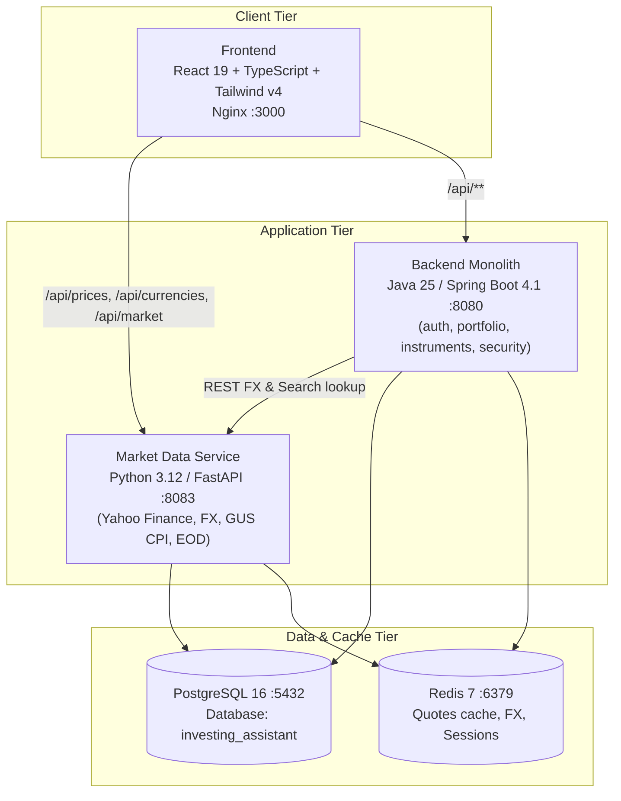

# InvestingAssistant - Wealth & Portfolio Intelligence 📈💼


---

## 📸 Screenshots

| Portfolio Dashboard | Live Market Search & Auto-Discovery |
| :---: | :---: |
|  |  |
| *Real-time valuation, Act/365 XIRR & CPI inflation hurdle* | *Debounced search across owned positions & Yahoo Finance* |

| Monthly & Annual Reports | Monte Carlo & Stress-Testing |
| :---: | :---: |
|  |  |
| *Monthly performance breakdown, cash flows & asset allocation* | *Long-term wealth projections & crisis resistance tests* |

---

## 📖 Project Description

**InvestingAssistant** is a modern, containerized wealth management and portfolio analytics platform engineered for long-term retail investors. Designed specifically for portfolios combining **Global Equities, UCITS ETFs**, and **Polish Retail Treasury Bonds (EDO, TOS, COI, ROR, DOR)**, the system unifies multi-currency transactions, official CPI inflation adjustments, and rigorous quantitative forecasting models into a single, self-hosted web interface.

Unlike generic stock trackers, InvestingAssistant analyzes your **actual asset allocation, historical monthly contribution pace (DCA), and bond cohorts** to project future wealth, simulate historical crisis scenarios, and calculate inflation-adjusted purchasing power.

---

## 🌟 Core Features & Capabilities

### 1. 🔮 Portfolio Forecasting & Crisis Stress-Testing (Based on Your Real Holdings)
- **Automatic Historical DCA Detection**: Analyzes your transaction history to automatically determine your real monthly contribution pace across asset classes (fixed-rate bonds, inflation-indexed bonds, and equity ETFs).
- **Interactive Forward Projections**: Adjust your monthly DCA allocations via live sliders and project capital accumulation under varying market regimes.
- **Historical Crisis Replay Scenarios**:
  - **COVID-19 Flash Crash (2020)**: -34% equity shock with a fast V-shaped recovery and near-zero interest rates.
  - **Global Financial Crisis (2007–2009)**: -55.5% deep prolonged equity drawdown across a 48-month horizon.
  - **Stagflation & War Shock (2021–2023)**: Polish inflation spike up to 18.4% coupled with tech bear market (-28%), showcasing the defensive compounding of EDO/COI inflation-linked bonds.
- **Comparative Benchmarking**: Compares your actual custom allocation against **100% Global Stocks** and **100% Polish Treasury Bonds** in real time, calculating:
  - Exact maximum drawdown (% and native currency) at market trough.
  - Portfolio recovery speed (exact month when capital value crosses previous all-time highs thanks to DCA averaging).
  - Cushion factor provided by retail bonds during equity bear markets.

### 2. 🇵🇱 Polish Retail Treasury Bonds Engine
- **Full Series Coverage**: First-class support for **EDO** (10-year inflation-indexed), **COI** (4-year inflation-indexed), **TOS** (3-year fixed), **ROR**, and **DOR** bonds.
- **Dynamic Yield & CPI Compounding**: Models compounding interest for multi-year bonds, annual non-compounded coupon payments for COI, and margin adjustments based on live GUS CPI data.
- **Maturity Caps**: Strictly caps interest accumulation once a bond series reaches its maturity date, eliminating artificial yield drift.
- **Cohort Grouping**: Groups individual bond purchases by series identifier (e.g., `EDO1034`, `TOS0227`) displaying purchase dates, current coupon rates, and accumulated interest.

### 3. 🔍 Live Market Search & Auto-Discovery
- **Instant Yahoo Finance Search**: 250ms debounced search modal queries global exchanges for any equity or ETF ticker (e.g., `AMZN`, `TSLA`, `VWCE.DE`, `SXR8.DE`, `PKO.WA`).
- **Two-Tier Dropdown**: Categorizes search results into **"Your Instruments"** (owned assets for fast DCA additions) and **"All Instruments"** (global market catalog).
- **Automatic Persistence**: Discovered market instruments are automatically registered in the unified PostgreSQL database with generated UUIDs and currency mapping.

### 4. 📐 Quantitative Financial Metrics
- **Act/365 Money-Weighted Return (XIRR)**: Rigorous annual percentage yield computation using a Newton-Raphson numerical solver with bisection fallback and a 30-day maturity guardrail.
- **CPI Inflation Hurdle & Real Purchasing Power**: Fetches official Polish CPI statistics (GUS BDL) to calculate inflation hurdles and real returns using the **Fisher equation**:
  $$(1 + r_{\text{nominal}}) = (1 + r_{\text{real}})(1 + i)$$
- **Foreign Exchange (FX) Decomposition**: Decomposes returns on foreign assets into underlying market price performance and currency drag/appreciation:
  $$(1 + R_{\text{total}}) = (1 + R_{\text{asset}})(1 + R_{\text{fx}})$$
- **FIFO Cost Basis Deduction**: Accurately processes partial or full SELL transactions, reducing average cost basis proportionally and recording realized gains.

### 5. 📊 Reports, Tax Accounts & Internationalization
- **Calendar Performance Matrix**: Monthly and annual profit/loss matrices, cash flow breakdowns, and visual asset allocation donuts.
- **Multi-Account Tax Modeling**: Create isolated portfolios to compare taxable accounts (19% Polish Belka capital gains tax) against tax-free IKE/IKZE retirement accounts.
- **Bilingual Interface**: Full Polish and English language toggle powered by `i18next`.

---

## 🏗️ System Architecture

The application is structured into containerized microservices communicating over a private Docker network:



### Backend (Spring Boot)
- **Framework**: Spring Boot 4.1.0
- **Language**: Java 25 (Eclipse Temurin)
- **Database**: PostgreSQL 16 via Spring Data JPA / Hibernate
- **Cache**: Redis 7 via Spring Data Redis
- **Security**: Spring Security with stateless JWT authentication & BCrypt password hashing
- **Build Tool**: Maven with multi-stage Docker compilation

### Market Data Service (FastAPI)
- **Framework**: FastAPI (ASGI with Uvicorn)
- **Language**: Python 3.12
- **Financial Data**: `yfinance` with Redis caching layer (1h TTL for search, 15m for live prices)
- **Macro Data**: GUS BDL API for Polish CPI inflation series
- **Storage**: PostgreSQL connection pool for historical End-of-Day (EOD) quote storage

### Frontend (React + TypeScript)
- **Framework**: React 19.2.8
- **Language**: TypeScript 6.0 / 5.7
- **Styling**: Tailwind CSS v4
- **State Management**: Redux Toolkit & React-Redux
- **Data Visualization**: Lightweight Charts & Recharts
- **Internationalization**: `i18next` with browser language detection (English & Polish)
- **Build Tool**: Vite 8

---

## 🚀 Installation and Setup

### Prerequisites
- **Docker** ($\ge 24.0$) and **Docker Compose**
- **Git**

### 1. Clone the Repository
```bash
git clone https://github.com/elzyr/InvestingAssistant.git
cd InvestingAssistant
```

### 2. Configure Environment Variables
Create a `.env` file in the project root:
```env
DB_NAME=investing_assistant
DB_USER=investassist
DB_PASSWORD=your_secure_db_password
JWT_SECRET=your_super_secret_jwt_key_at_least_256_bits_long
```

### 3. Run with Docker Compose (Recommended)
```bash
docker compose up -d --build
```

Once the containers are running, access the services:
- **Web Application**: [http://localhost:3000](http://localhost:3000)
- **Backend API**: [http://localhost:8080/api](http://localhost:8080/api)
- **Market Data API**: [http://localhost:8080/api/prices](http://localhost:8080/api/prices) (reverse-proxied via Nginx)

---

## 🛠️ Technologies Used

### Backend Technologies
- **Java 25** – modern high-performance Java runtime
- **Spring Boot 4.1.0** – enterprise application framework
- **Spring Security** – stateless token-based authorization
- **Spring Data JPA** – relational persistence mapping
- **PostgreSQL 16** – unified ACID relational database
- **Redis 7** – fast in-memory caching and session store
- **jjwt** – JSON Web Token signing and parsing
- **Maven** – dependency management and automated builds

### Market Data Technologies
- **Python 3.12** – backend language for financial data processing
- **FastAPI** – high-performance asynchronous REST API framework
- **yfinance** – real-time quotes and ticker search from global exchanges
- **NumPy** – numerical routines for financial time series
- **psycopg2** – PostgreSQL database adapter with connection pooling

### Frontend Technologies
- **React 19.2** – modern declarative user interface library
- **TypeScript 6.0** – static typing for financial calculations
- **Tailwind CSS v4** – zero-runtime utility-first styling
- **Redux Toolkit** – centralized state store
- **Lightweight Charts** – interactive canvas-based performance charts
- **Recharts** – modular composable SVG charts
- **Lucide React** – modern interface icon set
- **i18next** – localization engine for multi-language support
- **Vite 8** – next-generation frontend tooling and bundler

---

## 🧪 Testing

### Backend Unit & Integration Tests (Java)
```bash
cd backend
./mvnw test
```

### Market Data Service Tests (Python)
```bash
docker run --rm -v "${PWD}/market-data-service:/app" -w /app investingassistant-market-data-service python -m unittest discover tests
```

### Financial Engine & Search Tests (Frontend)
```bash
node --test frontend/src/utils/xirrEngine.test.mjs
node --test frontend/src/utils/instrumentSearch.test.mjs
```

---

## 📁 Screenshot Setup

Place your application screenshots into the `docs/screenshots/` directory:
- `docs/screenshots/dashboard.png`
- `docs/screenshots/transaction_search.png`
- `docs/screenshots/monthly_reports.png`
- `docs/screenshots/monte_carlo.png`

---

## 📄 License

This project is licensed under the MIT License.
